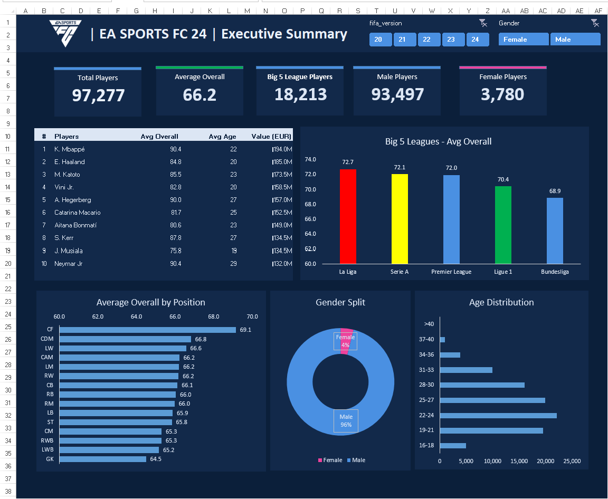
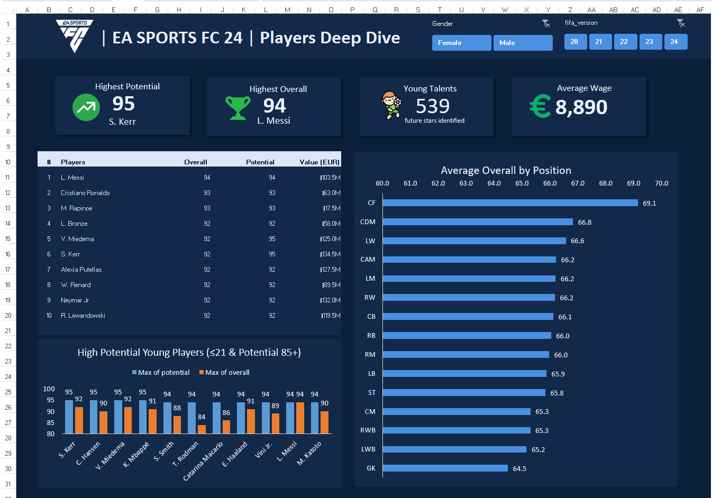
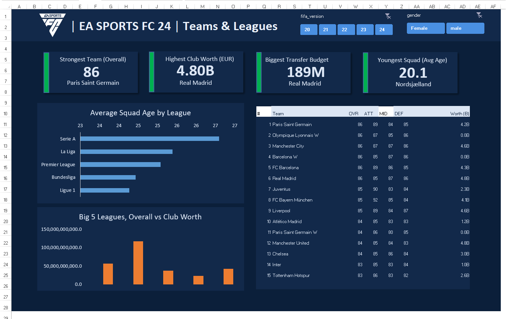

# EA SPORTS FC 24 Player, Team & League Analysis

An interactive Excel analysis of player and club attributes across the FIFA 20–24 editions represented in the workbook. The dashboards bring player ratings, potential, age, wages and market values together with team strength, squad profiles, club worth, transfer budgets and league comparisons.

**Microsoft Excel · PivotTables · PivotCharts · Slicers · Dashboard design**

---

## Why this project

Player and club data contains many attributes that are difficult to compare in a flat table. This project turns those records into filterable views for exploring player profiles, team characteristics and differences between leagues and game editions.

The workbook is designed to answer questions such as:

1. How do player ratings and age profiles vary by position and league?
2. Which players combine high overall ratings, potential or in-game value?
3. How do the player and team summaries change across FIFA editions and gender selections?
4. Which clubs lead the displayed team-strength, club-worth and transfer-budget measures?
5. How does squad age vary across the leagues in the dashboard?

---

## Data and workbook structure

The supplied workbook contains two data sheets and supporting calculation sheets:

- `Players_Data` — **97,277 player records** across the FIFA 20–24 editions shown in the workbook filters.
- `Teams_Data` — **3,771 team records**.
- `Calc_Summary`, `Calc_Players` and `Calc_Teams` — calculation views that support the dashboard pages.
- `01_Summary`, `02_Players` and `03_Teams` — the three presentation dashboards.

The workbook includes **18 PivotTables, eight charts, and slicer controls**. FIFA version and gender filters are visible on the dashboard pages. The source-data origin is not identified in the workbook, so this project does not claim an external dataset citation.

---

## What I built

### 1. Summary analysis

Created a high-level view of player counts, average overall rating, Big Five league representation, and the male/female split. Ranked players and comparisons by league, position and age distribution make it possible to move from headline figures to specific player groups.

### 2. Player analysis

Built a player-focused view for comparing overall rating, potential, age, in-game value and wages. The page highlights the highest overall and potential ratings and identifies a young-talent segment using the dashboard's displayed rule: **under 21 years old and potential of 85 or higher**.

### 3. Team and league analysis

Created comparisons for team overall strength, club worth, transfer budget and average squad age. The team table shows overall, attack, midfield and defence ratings alongside club worth, while the league charts compare age and club-worth measures.

### 4. Interactive reporting

Organised the source records and supporting calculations into separate sheets, then used PivotTables, PivotCharts and slicers to make the three dashboards filterable. This keeps the headline measures, player rankings and team/league comparisons available in one workbook.

---

## Dashboard snapshot

The figures below describe the supplied dashboard view with the available FIFA-version and gender selections applied. They are workbook outputs, not current real-world player or club statistics.

- **97,277 players** and an **average overall rating of 66.2** appear in the executive summary.
- The Big Five league view contains **18,213 players**; the summary shows **93,497 male** and **3,780 female** players.
- The player page highlights **S. Kerr at 95 potential**, **L. Messi at 94 overall**, and **539 young talents** under the page's under-21 / potential-85 rule. Average wage is shown as **€8,890**.
- The team page lists **Paris Saint-Germain at 86 overall** as the strongest team. **Real Madrid** leads the displayed club-worth and transfer-budget cards at **€4.80B** and **€189M**; **Nordsjælland** has the youngest average squad age at **20.1**.

These are descriptive comparisons. The workbook does not establish why a player, team or league has a particular rating or value.

---

## Skills demonstrated

- **Excel data organisation:** worked with separate player and team tables and kept supporting calculation sheets distinct from dashboard presentation sheets.
- **PivotTable analysis:** summarised player and team attributes into comparable groups and rankings.
- **Interactive analysis:** used FIFA-version and gender slicers so the dashboard views can be explored by selection.
- **KPI and comparison design:** presented player counts, average ratings, position and league comparisons, age profiles, wages, values and club measures.
- **Chart selection and dashboard layout:** combined ranked tables, bar charts, age distributions and a gender split across three audience-focused pages.
- **Metric communication:** labelled the young-talent definition directly and paired headline cards with supporting charts and tables.

---

## Dashboard pages

### Executive summary

### Players deep dive

### Teams and leagues

---

## Explore the workbook

[Download the Excel analysis workbook](ANALYSIS%20SHEETS.xlsx)

Open the workbook in Excel and use the FIFA-version and gender slicers to explore the dashboard views. The screenshots above are static previews; the workbook contains the interactive controls and supporting sheets.

## Scope and limitations

- Player ratings, wages, values and club measures are **in-game dataset attributes**, not real-world performance, salary or financial statements.
- The results reflect the records and filters in the supplied workbook. They should not be read as current football data.
- The workbook does not identify the original dataset source or document a separate data-cleaning process; neither is claimed here.
